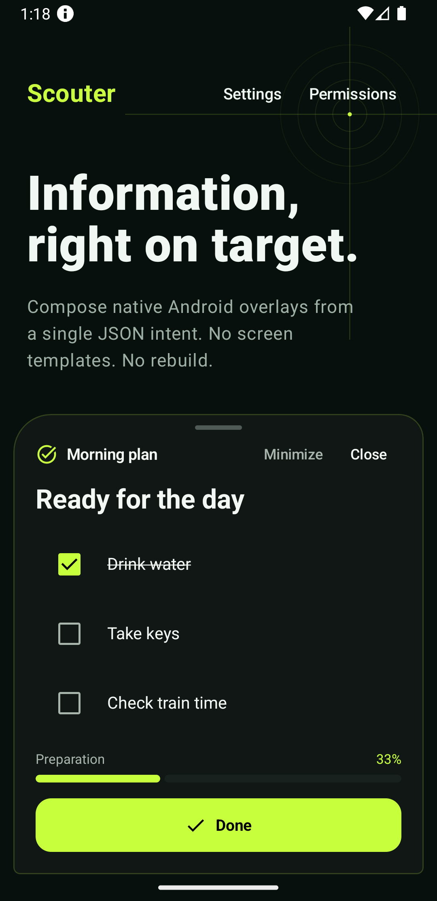
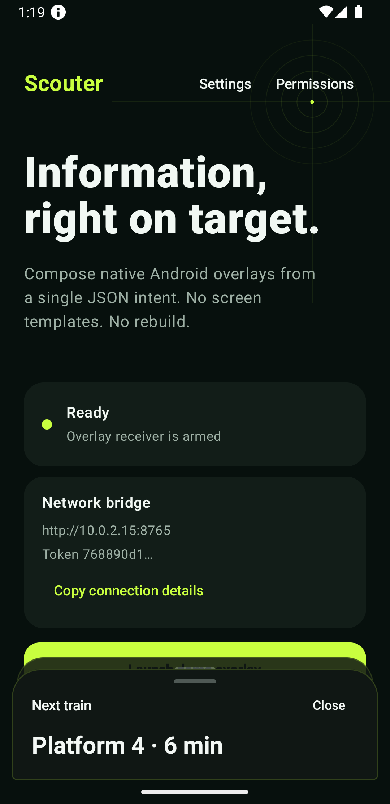
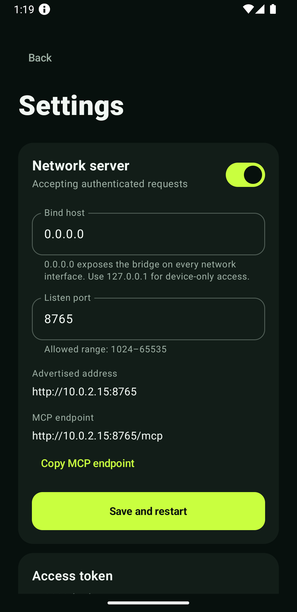

<div align="center">
  <h1>Scouter</h1>
  
  <p>Native Android interfaces, composed from JSON and displayed over any app.</p>
</div>

<p align="center">
  
  
  
</p>

Scouter is a small server-driven UI renderer for Android. Send one JSON document through an intent, HTTP, or MCP; Scouter turns it into a native bottom sheet with no predefined screen or template.

Sheets slide up from the bottom, stack when their IDs differ, and update in place when an ID is reused. They can also be minimized into local notifications and restored without opening the main activity.

## What it handles

- Native text, cards, rows, columns, grids, buttons, progress, images, and dividers
- Checklists, links, addresses, phone numbers, maps, videos, and controlled web content
- Press-and-hold and slide actions with configurable vibration
- Per-view colors, spacing, typography, borders, opacity, and four independent corner radii
- Stable-ID replacement and multiple stacked overlays
- Lock-screen queueing through local notifications
- Android intents, authenticated REST, and embedded MCP

## Install

Requirements:

- Android 8.0 or newer
- Display-over-other-apps permission
- Notification permission on Android 13+

```bash
MAPS_API_KEY="your-restricted-google-maps-key" \
  gradle :app:assembleDebug

adb install -r app/build/outputs/apk/debug/app-debug.apk
```

Open Scouter once, grant the requested permissions, then use the built-in demo or send a document.

The Google Maps key is optional. When supplied, restrict it to package `app.scouter` and the signing certificate SHA-1.

## Send a view

Every document has a protocol version, a stable ID, and a recursive content tree:

```json
{
  "version": 1,
  "id": "delivery-42",
  "title": "Courier",
  "titleIcon": "directions",
  "notification": {
    "title": "Courier approaching",
    "message": "Arrival expected in 3 minutes",
    "icon": "navigation"
  },
  "presentation": {
    "dismissible": true,
    "minimizable": true,
    "radius": {
      "topStart": 30,
      "topEnd": 30,
      "bottomEnd": 6,
      "bottomStart": 6
    }
  },
  "content": {
    "type": "column",
    "gap": 14,
    "children": [
      {
        "type": "text",
        "value": "3 minutes away",
        "variant": "title"
      },
      {
        "type": "progress",
        "label": "Route",
        "value": 0.72,
        "showValue": true
      },
      {
        "type": "button",
        "id": "dismiss",
        "label": "Dismiss",
        "action": {"type": "close"}
      }
    ]
  }
}
```

The complete machine-readable contract lives in [`scouter.schema.json`](./scouter.schema.json).

### Android intent

Scouter listens for implicit broadcasts:

```kotlin
sendBroadcast(
    Intent("app.scouter.SHOW").apply {
        putExtra("scouter_id", "delivery-42")
        putExtra("scouter_json", documentJson)
    }
)
```

```bash
adb shell am broadcast \
  -a app.scouter.SHOW \
  --es scouter_id delivery-42 \
  --es scouter_json '{"version":1,"id":"delivery-42","content":{"type":"text","value":"Arriving now","variant":"title"}}'
```

Other actions:

- `app.scouter.CLOSE` with `scouter_id`
- `app.scouter.CLOSE_ALL`

### REST

The authenticated listener uses the host and port configured in Settings.

```bash
curl \
  -H "Authorization: Bearer $SCOUTER_TOKEN" \
  -H "Content-Type: application/json" \
  --data-binary @view.json \
  http://100.64.0.2:8765/show
```

Available routes:

- `GET /health`
- `POST /show`, optionally with `X-Scouter-Id`
- `POST /close/{id}`
- `POST /close-all`

Binding to `0.0.0.0` listens on every interface. If Tailscale is available, Scouter advertises its `100.64.0.0/10` address before Wi-Fi. A specific IPv4 address can be entered to force one interface.

### MCP

The same listener exposes stateless Streamable HTTP at `/mcp`.

```json
{
  "mcpServers": {
    "scouter": {
      "url": "http://100.64.0.2:8765/mcp",
      "headers": {
        "Authorization": "Bearer <token shown in Scouter>"
      }
    }
  }
}
```

Tools:

- `scouter_show(document, id?)`
- `scouter_close(id)`
- `scouter_close_all()`
- `scouter_get_schema()`
- `scouter_status()`

MCP controls Scouter views only. It does not inject arbitrary intents, read device data, simulate touch, or bypass Android permissions.

For an emulator:

```bash
adb forward tcp:8765 tcp:8765
```

Then connect REST or MCP to `http://127.0.0.1:8765`.

## UI language

Layout:

- `column`, `row`, `grid`, `box`, `card`
- `spacer`, `divider`

Content:

- `text`, `badge`, `progress`, `image`
- `checklist`
- `link`, `link_list`
- `address`, `address_list`
- `phone`, `phone_list`
- `action_list`
- `map`, `video`, `web`

Interaction:

- `button`
- `hold_button`
- `slide_action`

Actions can close the sheet, open a trusted HTTP(S) URL, open navigation, open the dialer, or send a package-targeted callback broadcast.

Every component accepts a `style` object for dimensions, weight, padding, margin, background, opacity, radius, and border. Interactive elements require stable semantic IDs.

## Overlay lifecycle

- A new ID creates another independently stacked sheet.
- Reusing an ID replaces the current or queued document and raises it.
- Minimizing stores the document and creates a configurable local notification.
- When Android is locked, incoming views are queued instead of forcing an overlay.
- Tapping the notification restores only the requested sheet over the current app.
- `CLOSE` removes both visible and queued views.

## Safety

- The network listener requires a bearer token.
- Payloads are limited to 256 KiB, 120 components, and 12 nesting levels.
- Remote web pages cannot use the JavaScript bridge.
- URL actions accept HTTP(S); phone actions open the dialer without placing a call.
- Sensitive or destructive work should always require an explicit confirmation.
- Use Scouter on a trusted LAN or through a private network such as Tailscale.

## Desktop console

The included local console can generate and send varied documents:

```bash
python3 desktop/scouter_console.py
```

Open `http://127.0.0.1:8787`, then enter the address and token shown in Scouter.

## Project references

- JSON contract: [`scouter.schema.json`](./scouter.schema.json)
- Agent skill: [`.cursor/skills/scouter-sdui/SKILL.md`](./.cursor/skills/scouter-sdui/SKILL.md)
- Android renderer: [`app/src/main/java/app/scouter/ui/ScouterRenderer.kt`](./app/src/main/java/app/scouter/ui/ScouterRenderer.kt)

